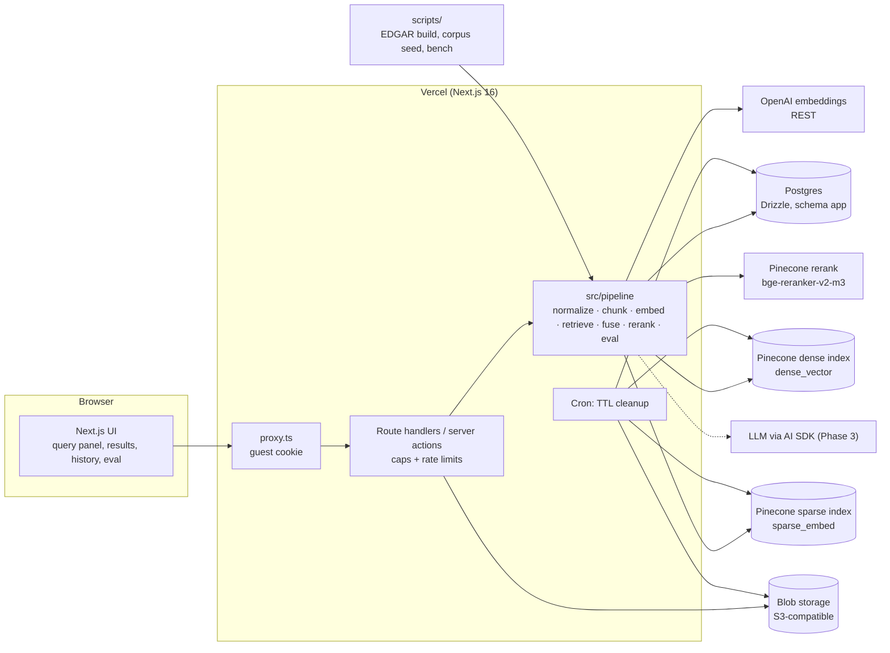
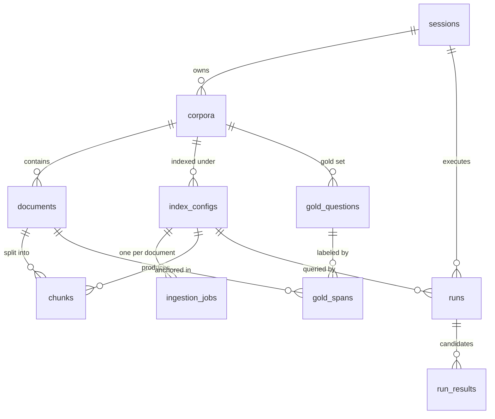
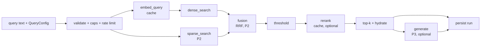

# Architecture

**Status:** baseline for Phase 0 · **Last updated:** 2026-11-07

This is the reference for how the system works. ADRs in `docs/decisions/` record why. When a story
changes something here, update this file in the same commit.

## 1. System overview



`src/pipeline/` is the hand-built core and has no Next.js imports, so the same code runs in route
handlers, CLI scripts, Vitest, and (Phase 4) promptfoo. Clients for OpenAI, Pinecone, and Postgres
are injected so tests can use fakes.

## 2. Two kinds of knobs

| Kind               | Knobs                                                                                                                                                                 | Effect                                     | Changing it means                                          |
| ------------------ | --------------------------------------------------------------------------------------------------------------------------------------------------------------------- | ------------------------------------------ | ---------------------------------------------------------- |
| **Ingestion-time** | chunker (fixed-token, recursive, heading-aware; later semantic), chunk size, overlap, embedding model and dimensions, contextual chunk headers (P4), chunker version  | What is stored in Postgres and Pinecone    | A **new index config** (new namespace, re-chunk, re-embed) |
| **Query-time**     | mode (dense, sparse, hybrid), top-k, candidate pool size, hybrid alpha, RRF k, rerank on/off, rerank model, rerank depth, score threshold; later query rewriting (P4) | How stored vectors are searched and ranked | Nothing stored changes. Runs instantly                     |

**Rule:** a query-time knob never triggers re-embedding or re-chunking. Query embeddings are cached.

### Index config params (ingestion-time)

```ts
// src/pipeline/config/index-config.ts (Zod). Canonicalized and hashed (params_hash).
type IndexConfigParams = {
  chunker: "fixed_token" | "recursive" | "heading_aware";
  chunkerVersion: number; // bump when a chunker's output changes for the same input
  chunkSize: number; // tokens (cl100k_base), 128–1024
  chunkOverlap: number; // tokens, 0 ≤ overlap ≤ chunkSize / 2
  embedding: { model: string; dimensions: number }; // e.g. text-embedding-3-small / 1536
  contextualHeaders: boolean; // Phase 4; false until then
  sparse: boolean; // Phase 2; true once sparse ingestion exists
};
```

### Query config (query-time)

```ts
// src/pipeline/config/query-config.ts (Zod)
type QueryConfig = {
  mode: "dense" | "sparse" | "hybrid"; // Phase 1: "dense" only
  topK: number; // final results shown, 1–50, default 10
  candidateK: number; // pool per retriever, 10–100, default 50
  fusion: { method: "rrf"; alpha: number; k: number } | null; // hybrid only; alpha ∈ [0,1], k default 60
  rerank: { enabled: boolean; model: string; depth: number }; // depth = candidates sent, ≤ 100
  scoreThreshold: { stage: "dense" | "rerank"; min: number } | null;
  // Phase 3: generation: { enabled; model; promptVersion } | null
};
```

`rerank.depth` is the "rerank top-n" knob in the UI: how many top candidates go to the reranker.
`topK` is how many results are returned after everything. Pinecone's `topN` rerank parameter is set
to `depth` so every sent candidate gets a rerank score (needed for rank-movement views).

## 3. Ownership model: session → corpus → index config → namespace



- A **corpus** is a set of documents. The EDGAR corpus is **shared** (`session_id IS NULL`,
  read-only for guests). Each guest gets at most one private corpus ("My uploads").
- An **index config** belongs to exactly one corpus and owns exactly one namespace, `cfg-<uuid>`,
  in each Pinecone index it uses. This is the seed's "namespace per (session, index config)": a
  guest config lives in a guest corpus, so its namespace is per session by construction.
- The shared corpus has a fixed set of **preset index configs** created by the seed script. Guests
  query presets; they cannot add configs to the shared corpus (cost and benchmark stability).
- Adding a document to a corpus enqueues ingestion jobs for every existing config of that corpus.

## 4. Pinecone layout

Verified against Pinecone docs on 2026-11-07 (API version `2026-07`, Documents API). Links in
ADRs 0005, 0006, 0008.

| Index                                                 | Kind                              | Schema (fields)                                                                                                                            | Written in |
| ----------------------------------------------------- | --------------------------------- | ------------------------------------------------------------------------------------------------------------------------------------------ | ---------- |
| `rag-playground-dense` (env `PINECONE_DENSE_INDEX`)   | Document index, our vectors       | `embedding: dense_vector(1536, cosine)`; stored fields `chunk_text`, `document_id`, `index_config_id`, `ordinal`, `start_char`, `end_char` | Phase 1    |
| `rag-playground-sparse` (env `PINECONE_SPARSE_INDEX`) | Document index, integrated sparse | `chunk_text: string` with `sparse_embed: pinecone-sparse-english-v0` (`max_tokens_per_sequence` 2048); same stored fields                  | Phase 2    |

- **Namespaces:** `cfg-<index_config_uuid>` in both indexes. Same document `_id` (chunk ID) in both,
  so fusion joins on ID.
- **Chunk ID:** deterministic `<index_config_id>:<document_id>:<ordinal>`. Re-ingesting overwrites,
  making ingestion idempotent.
- **Dense index per embedding space:** a `dense_vector` field has a fixed dimension, so each
  (embedding model, dimensions) pair gets its own dense index. Phase 1 has one; P4-06 adds a
  registry `{ "text-embedding-3-small@1536": "rag-playground-dense", ... }`.
- **Search:** each search request has exactly one `score_by` clause (`dense_vector` or
  `sparse_embed`). Pinecone does no server-side dense+sparse fusion here; fusion is ours by
  construction.
- **Rerank:** standalone `inference.rerank` over candidate texts (not part of the search request).
- **Limits that shape the design** (Starter plan): 5 indexes per project, **100 namespaces per
  index**, 2 GB storage, 1M read units and 2M write units per month, 5M embedding tokens per model
  per month, **500 rerank requests per month** (`bge-reranker-v2-m3` only). Builder ($20 flat):
  1,000 reranks/month and quota blocks instead of overage. Standard ($50/month minimum): pay as you
  go, `$2 / 1k` rerank requests, Cohere Rerank 4 Fast available. Upserts: 1,000 records / 2 MB per
  batch for our own vectors, 96 per batch when Pinecone embeds the text. See open questions for the
  plan decision.

## 5. Data model

All tables live in the Postgres schema `app` (not `public`), so a hosted provider's auto-generated
REST API does not expose them. Drizzle schema in `src/db/schema.ts`; migrations in `drizzle/`.
Phase 0 creates the tables below; later phases add tables with their own migrations.

| Table                | Key columns                                                                                                                                                                                                                                                                                                              | Notes                                                                                                                                                     |
| -------------------- | ------------------------------------------------------------------------------------------------------------------------------------------------------------------------------------------------------------------------------------------------------------------------------------------------------------------------ | --------------------------------------------------------------------------------------------------------------------------------------------------------- |
| `sessions`           | `id uuid pk`, `created_at`, `last_seen_at`, `expires_at`, `ip_hash`, `embed_tokens_used bigint`, `rerank_requests_used int`                                                                                                                                                                                              | Row created lazily on first stateful action, not on every page view                                                                                       |
| `corpora`            | `id`, `session_id null → sessions (cascade)`, `slug`, `name`, `description`, `is_shared`, `created_at`                                                                                                                                                                                                                   | `session_id IS NULL` ⇔ shared                                                                                                                             |
| `documents`          | `id`, `corpus_id → corpora (cascade)`, `title`, `source_type (md, txt, html, edgar_10k; pdf in P4)`, `original_filename`, `original_blob_key null`, `original_bytes`, `normalized_text text`, `content_hash`, `normalization_version`, `char_count`, `token_count`, `metadata jsonb`, `created_at`                       | Immutable after insert. `unique(corpus_id, content_hash)`. EDGAR metadata: ticker, CIK, fiscal year, accession number, filing date                        |
| `index_configs`      | `id`, `corpus_id → corpora (cascade)`, `name`, `params jsonb`, `params_hash`, `chunker`, `chunk_size`, `chunk_overlap`, `embedding_model`, `embedding_dimensions`, `namespace unique`, `status (pending, indexing, ready, failed, deleting)`, `is_preset`, `created_at`                                                  | Params immutable. `unique(corpus_id, params_hash)`. Flattened columns duplicate `params` for querying                                                     |
| `ingestion_jobs`     | `id`, `index_config_id (cascade)`, `document_id (cascade)`, `status (queued, running, succeeded, failed)`, `stage`, `chunks_total`, `chunks_done`, `embed_tokens`, `attempts`, `last_error`, `lease_expires_at`, `started_at`, `finished_at`                                                                             | `unique(index_config_id, document_id)`                                                                                                                    |
| `chunks`             | `id text pk` (deterministic), `index_config_id (cascade)`, `document_id (cascade)`, `ordinal`, `start_char`, `end_char`, `text`, `heading_path text[]`, `token_count`                                                                                                                                                    | `text` is exactly what was embedded. For plain chunks, `text = normalized_text.slice(start_char, end_char)`                                               |
| `runs`               | `id`, `session_id null (cascade)`, `corpus_id`, `index_config_id null (set null)`, `index_config_snapshot jsonb`, `query_config jsonb`, `query_text`, `gold_question_id null`, `replay_of_run_id null`, `status`, `error`, `latency_ms jsonb`, `usage jsonb`, `est_cost_usd numeric`, `metrics jsonb null`, `created_at` | Immutable. Snapshots make it self-contained even if the config is deleted. `session_id IS NULL` for owner/benchmark runs                                  |
| `run_results`        | `run_id (cascade)`, `chunk_id`, `document_id`, `start_char`, `end_char`, `text`, `heading_path`, `dense_score`, `dense_rank`, `sparse_score`, `sparse_rank`, `fused_score`, `fused_rank`, `pre_rerank_rank`, `rerank_score`, `rerank_rank`, `final_rank null`, `passed_threshold`                                        | One row per **candidate** (up to `candidateK`), not just the top-k, so views can show chunks that moved out. `final_rank IS NULL` ⇒ not in returned top-k |
| `gold_questions`     | `id`, `corpus_id (cascade)`, `session_id null (cascade)`, `external_id`, `question`, `question_type`, `split (dev, test, none)`, `reference_answer null`, `gold_set_version null`, `notes`, `created_at`                                                                                                                 | `session_id IS NULL` ⇒ curated. Guest labels on the shared corpus are session-scoped and never modify the curated set                                     |
| `gold_spans`         | `id`, `gold_question_id (cascade)`, `document_id (cascade)`, `start_char`, `end_char`, `grade smallint (0 judged-not-relevant, 1 relevant, 2 highly relevant)`, `is_coarse`, `source (curated, ui_label)`, `created_at`                                                                                                  | Config-independent. See §11                                                                                                                               |
| `rate_limit_buckets` | `key`, `window_start`, `count`; pk `(key, window_start)`                                                                                                                                                                                                                                                                 | Fixed-window counters. Pruned by cleanup cron                                                                                                             |

Added later: `inference_cache` (P1-15: query embeddings and rerank responses), `eval_batches`
(P2-13), `run_generations` and `judge_scores` (Phase 3).

## 6. Document normalization

Every input becomes **normalized markdown** before chunking: one chunking path, stable offsets.

1. Decode as UTF-8 (reject invalid input). Unicode **NFC**. Newlines → `\n`. Strip BOM and control
   characters other than `\n` and `\t`. Collapse runs of 3+ blank lines to 2. Trim trailing spaces.
2. By type: **md** passes through step 1. **txt** passes through step 1 (no markdown inference).
   **html** is converted to markdown (headings, lists, links, GFM tables; scripts, styles, and
   hidden elements dropped), then step 1. **EDGAR 10-K** HTML goes through the offline
   preprocessing script (§6.1), which commits the result as a fixture.
3. Store `normalized_text`, `content_hash = sha256(normalized_text)`, and `normalization_version`.

**Offsets** are JS string indices (UTF-16 code units) into `normalized_text`. Documents are
immutable: a normalization change creates a new document (new hash). Gold fixtures store the span
text and the document content hash so a test can prove every span still slices correctly.

### 6.1 EDGAR preprocessing (offline)

`scripts/edgar/` fetches each filing's primary 10-K document via the EDGAR submissions API, with a
descriptive `User-Agent` (`SEC_USER_AGENT`) and at most a few requests per second (SEC cap is 10/s).
Raw HTML is cached in `.cache/edgar/` (gitignored). The cleaner removes the inline XBRL header
(`ix:header`) and hidden elements, unwraps `ix:*` tags while keeping their text, drops page
headers/footers and page-number lines, converts tables to GFM (collapsing spacer cells), and marks
the 10-K item structure (`Item 1. Business`, `Item 1A. Risk Factors`, `Item 7. MD&A`, ...) as
markdown headings so the heading-aware chunker has real structure. Output:
`fixtures/edgar/<TICKER>-FY<year>.md` plus `fixtures/edgar/manifest.json` (ticker, CIK, accession
number, filing date, fiscal year, source URL, content hash, token count).

## 7. Chunking

All chunkers are hand-written pure functions in `src/pipeline/chunking/`:

```ts
type ChunkSpan = {
  ordinal: number;
  start: number;
  end: number;
  text: string;
  headingPath: string[];
  tokenCount: number;
};
type Chunker = (
  doc: { text: string },
  p: { chunkSize: number; chunkOverlap: number },
) => ChunkSpan[];
```

| Chunker         | Behavior                                                                                                                                                                                               |
| --------------- | ------------------------------------------------------------------------------------------------------------------------------------------------------------------------------------------------------ |
| `fixed_token`   | Token windows of `chunkSize` with `chunkOverlap`, boundaries snapped to whitespace so offsets stay exact                                                                                               |
| `recursive`     | Split on the first separator that yields pieces ≤ `chunkSize` (`\n\n`, `\n`, sentence end, space, character), then merge adjacent pieces up to `chunkSize` with overlap                                |
| `heading_aware` | Split on ATX headings (`#`..`######`, ignoring fenced code); each section carries its heading path; oversized sections are sub-split with `recursive`; GFM tables are not split mid-row when avoidable |

**Invariants (tested for every chunker on every fixture):** `0 ≤ start < end ≤ text.length`;
`text === doc.slice(start, end)`; ordinals are 0..n-1 in document order; starts are non-decreasing;
the union of spans covers every non-whitespace character; `tokenCount ≤ chunkSize` (except a single
unsplittable token run, flagged). Token counts use `cl100k_base`, the tokenizer of the
`text-embedding-3-*` models.

Contextual chunk headers (P4-03) change the **embedded text** (document title + heading path
prepended) but never the span: offsets still point at the original text.

## 8. Ingestion pipeline

```mermaid
sequenceDiagram
  participant U as Guest / seed script
  participant API as Route handler
  participant J as Job runner (after())
  participant PG as Postgres
  participant OA as OpenAI
  participant PD as Pinecone dense
  participant PS as Pinecone sparse (P2)
  U->>API: create index config / add document
  API->>API: validate (Zod), check caps
  API->>PG: insert index_config (+namespace), ingestion_jobs (queued)
  API-->>U: 202 + job ids
  API->>J: after(): process jobs within time budget
  loop per job, bounded batches
    J->>PG: claim job (lease), stage=chunk
    J->>J: chunk normalized_text by config
    J->>PG: upsert chunks (deterministic ids)
    J->>OA: embed batch (token-budgeted)
    J->>PD: upsert dense records to cfg-<id>
    J->>PS: upsert text records to cfg-<id> (Pinecone embeds)
    J->>PG: progress (chunks_done, embed_tokens), usage
  end
  J->>PG: job succeeded; config ready when all jobs succeed
  U->>API: poll progress (also resumes jobs whose lease expired)
```

- **Resumable:** each job has a stage and progress counters; every step is idempotent (deterministic
  chunk IDs, upserts). A job whose `lease_expires_at` has passed can be claimed again.
- **Bounded:** one invocation processes until a time budget (well under the function max duration),
  then stops; polling or the cron sweep resumes it. Typical guest documents finish in one pass.
- **Caps are checked before work starts** (estimated tokens from the normalized text) and usage is
  recorded as work completes.

## 9. Query pipeline (stage by stage)



| Stage           | Input → output                                                  | Timed as        | Notes                                                                                                                                                                                 |
| --------------- | --------------------------------------------------------------- | --------------- | ------------------------------------------------------------------------------------------------------------------------------------------------------------------------------------- |
| validate        | raw request → `QueryConfig`                                     | (not timed)     | Zod; caps and rate limits; resolve index config and namespace                                                                                                                         |
| embed_query     | text → vector                                                   | `embed_query`   | Cached by `(model, dims, sha256(text))`; cache hits report ~0 ms and `cached: true`                                                                                                   |
| dense_search    | vector → ≤ `candidateK` hits (id, cosine score)                 | `dense_search`  | `score_by: dense_vector` on `cfg-<id>`                                                                                                                                                |
| sparse_search   | text → ≤ `candidateK` hits (id, sparse score)                   | `sparse_search` | Phase 2. Runs in parallel with embed + dense. May return fewer than `candidateK`                                                                                                      |
| fusion          | two ranked lists → one ranked list                              | `fusion`        | Phase 2. Weighted RRF (§12.4). Dense-only mode skips it                                                                                                                               |
| threshold       | ranked list → filtered list                                     | (in `fusion`)   | `stage: "dense"` filters on cosine before rerank; `stage: "rerank"` filters after                                                                                                     |
| rerank          | top `depth` candidates → rerank scores and new order            | `rerank`        | Pinecone `bge-reranker-v2-m3`. Cached by `(model, sha256(query), ordered candidate ids + text hashes)`. Candidates beyond `depth` keep their pre-rerank order below the reranked ones |
| top-k + hydrate | ranked ids → results with text, offsets, heading path, document | `hydrate`       | One Postgres query by chunk IDs                                                                                                                                                       |
| generate        | results → streamed answer + citations                           | `generation`    | Phase 3                                                                                                                                                                               |
| persist         | everything → `runs` + `run_results`                             | `persist`       | Reported separately from retrieval total                                                                                                                                              |

`latency_ms` stores each stage plus `total` (wall clock, parallel stages overlap). `usage` stores
`embed_tokens`, `sparse_query_tokens`, `rerank_requests`, `read_units`, and (P3) LLM input/output
tokens; `est_cost_usd` is computed from the versioned price table in `src/lib/pricing.ts`.

## 10. Runs and replay

A run is an immutable snapshot: index config snapshot, query config, query text, every candidate
with all scores and ranks, latencies, usage, cost, and (once labeled) metrics. **Viewing** a past run
renders the snapshot with no external calls. **Re-running** executes the same snapshot now and
stores a new run with `replay_of_run_id`; the UI diffs the two result lists. Differences come from
model nondeterminism, cache misses, or index changes, and showing them is a feature.

## 11. Relevance labels are source spans

Chunks differ per config, so labels attach to **source spans**, not chunk IDs:
`gold_span = (document_id, start_char, end_char, grade)` in normalized text.

- **Coverage** of gold span g by chunk c: `cov(c, g) = |c ∩ g| / |g|`, where `∩` is character
  overlap within the same document.
- **Chunk relevance:** c is relevant to g if `cov(c, g) ≥ τ`. Default **τ = 0.5** (open question;
  benchmark also reports τ ∈ {any overlap, 0.5, 1.0} as a sensitivity check).
- **Curated labels** use the minimal evidence span (the sentence, table row with its header, or
  short passage that answers the question).
- **UI labels:** when a visitor marks a chunk relevant, they may highlight the evidence inside it;
  the highlighted range is stored. Without a highlight, the whole chunk span is stored with
  `is_coarse = true`. Coarse spans favor configs with chunk sizes similar to the labeling config;
  the curated benchmark uses no coarse spans.
- **Judged non-relevant:** marking a chunk not relevant stores its span with `grade = 0`. Metrics
  treat unjudged chunks as non-relevant (standard pooled-judgment assumption) and report
  `judged@k` (share of the top-k that overlaps any judged span) so missing judgments are visible.

## 12. Metrics

Definitions are fixed in ADR 0019 and implemented in `src/pipeline/eval/` with hand-computed tests.
For a question with relevant gold spans G (grade ≥ 1) and ranked results r₁..r_k:

1. **Claiming (dedup):** walk the ranking top-down. rᵢ _claims_ every gold span it covers
   (`cov ≥ τ`) that no higher-ranked result has claimed. gainᵢ = max grade among spans it newly
   claims, else 0. A result that only re-covers already-claimed spans gets 0, so redundant
   overlapping chunks are not rewarded.
2. **recall@k** = |spans claimed within top k| / |G|.
3. **MRR@k** = 1 / (rank of first result with gain > 0), or 0 if none in top k.
4. **nDCG@k** = DCG@k / IDCG@k, with DCG@k = Σᵢ (2^gainᵢ − 1) / log₂(i + 1); IDCG@k is the DCG of
   the ideal ranking where each gold span is claimed by its own result, sorted by grade, truncated
   at k. With binary grades this is the standard binary nDCG.
5. **judged@k** (diagnostic) = share of top-k results that overlap any judged span (grade ≥ 0).
6. Questions with |G| = 0 (type `unanswerable`) are excluded from retrieval metrics and used in
   Phase 3 for abstention.

Reported at k ∈ {5, 10}; the headline is **nDCG@10** on the **test split**. Batch scorecards report
the mean, a 95% bootstrap CI over questions, and per-question-type means. Config comparisons use a
paired bootstrap over questions for the delta's CI and report per-question wins/losses/ties.

### 12.4 Hybrid fusion (weighted RRF)

For a candidate d with rank r_dense(d) and r_sparse(d) (1-based; ∞ if absent from that list):

`score(d) = α · 1 / (k + r_dense(d)) + (1 − α) · 1 / (k + r_sparse(d))`, with k = 60 by default.

α = 1 reproduces the dense ranking; α = 0 reproduces the sparse ranking (property-tested). Ties
break by better dense rank, then chunk ID, so results are deterministic. Alpha is tuned on the
**dev split only**.

## 13. Benchmark methodology

- Fixtures: normalized EDGAR corpus and gold set, both with content hashes, committed.
- Matrix: chunkers × {dense-only, sparse-only, hybrid, hybrid + rerank} on preset configs, test
  split, fixed `candidateK`, `topK`, rerank depth. Alpha chosen on dev split and frozen.
- Output: `docs/benchmark/results-<date>.json` and a generated markdown table, with git SHA, gold set
  version and hash, model names, τ, and CI method. The README table is generated, never hand-edited.
- Known biases are stated next to the table: chunk-size bias in span coverage (bigger chunks cover
  more), small n (CIs), question-drafting bias (typed questions, per-type breakdown).

## 14. Generation (Phase 3, summary)

Retrieved chunks are numbered in the prompt; the model answers with inline `[n]` citations or
abstains with an explicit marker when context is insufficient. Citations map back to chunk IDs and
therefore to source spans. An LLM judge (a different model than the generator) scores faithfulness
(each claim supported by cited context) and citation correctness. Judge prompts are versioned and
calibrated against a small human-labeled set. Generation output, tokens, cost, and judge scores are
persisted on the run.

## 15. Guest sessions and guardrails

- **Cookie:** `rp_session = <uuid>.<issuedAt>.<HMAC-SHA256(secret, uuid.issuedAt)>`, HttpOnly,
  Secure, SameSite=Lax. `proxy.ts` issues it when missing or invalid (no DB access in the proxy).
  The `sessions` row is created lazily on the first stateful action, so crawlers create no rows.
- **Caps** (defaults in `src/lib/caps.ts`, overridable via env; values are an open question):

| Cap                                 | Default                      |
| ----------------------------------- | ---------------------------- |
| Max upload size (raw)               | 1 MB                         |
| Documents per session               | 10                           |
| Index configs per guest corpus      | 3                            |
| Embedded tokens per session         | 400k                         |
| Queries per minute per session      | 20                           |
| Queries per day per session         | 300                          |
| Rerank calls per session per day    | 30 (cache hits free)         |
| Global rerank calls per day         | plan-dependent (Starter: 15) |
| Global guest namespaces (per index) | 80 (Starter)                 |
| New sessions per IP-hash per hour   | 10                           |

- **Rate limits:** fixed-window counters in `rate_limit_buckets`, via one atomic
  `INSERT … ON CONFLICT DO UPDATE … RETURNING count`. No extra service.
- **Caches:** query embeddings and rerank responses in `inference_cache`; benchmark and repeated
  demo queries cost nothing after the first run.
- **TTL cleanup:** daily cron (`/api/cron/cleanup`, `CRON_SECRET`) deletes sessions idle longer
  than `GUEST_SESSION_TTL_HOURS` (default 72): Pinecone namespaces first (dense and sparse), then
  blobs, then rows (cascade). Also prunes old rate-limit buckets. Shared corpus is never touched.

## 16. Observability

Every pipeline stage runs inside `timeStage(trace, name, fn)` (`src/lib/timing.ts`), which records
duration and emits one structured JSON log line per request with stage timings, usage, and IDs.
Timings are persisted on the run and shown in the UI. Phase 4 can export the same spans via
OpenTelemetry.

## 17. External limits reference (verified 2026-11-07)

| Fact                                                                                         | Source                                                                                                |
| -------------------------------------------------------------------------------------------- | ----------------------------------------------------------------------------------------------------- |
| Pinecone Documents API, `score_by` single-clause rules, `include_fields`                     | https://docs.pinecone.io/reference/api/2026-07/data-plane/search_documents                            |
| Sparse model `pinecone-sparse-english-v0`: 512 tokens default, up to 2048; 96 inputs/request | https://docs.pinecone.io/models/pinecone-sparse-english-v0                                            |
| `bge-reranker-v2-m3`: 1024 tokens per query+doc pair, 100 docs/request                       | https://docs.pinecone.io/models/bge-reranker-v2-m3                                                    |
| Starter: 100 namespaces/index, 5 indexes, 500 reranks/month                                  | https://docs.pinecone.io/reference/api/database-limits                                                |
| Plan prices (Builder $20 flat, Standard $50 min, rerank $2/1k)                               | https://www.pinecone.io/pricing/                                                                      |
| SEC: declared User-Agent, max 10 requests/second                                             | https://www.sec.gov/os/accessing-edgar-data                                                           |
| Next.js 16 `proxy.ts`, `after()`, `maxDuration`                                              | `node_modules/next/dist/docs/`                                                                        |
| OpenAI `text-embedding-3-small` (1536 dims, ~8k tokens input)                                | https://platform.openai.com/docs/guides/embeddings (re-verify in P1-09)                               |
| Vercel function duration and cron frequency per plan                                         | https://vercel.com/docs/functions/limitations, https://vercel.com/docs/cron-jobs (re-verify in P0-06) |
